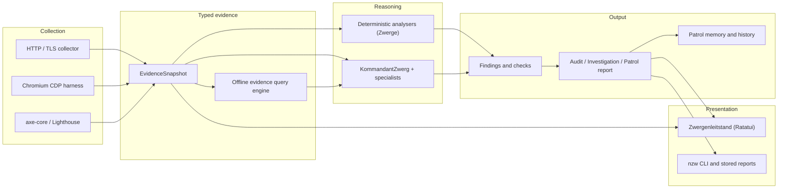

# NetzZwergenWacht

**Kleine Zwerge. Große Sorgfalt.**

NetzZwergenWacht is an evidence-driven external web quality and reliability auditing engine with
optional AI-assisted analysis. It collects typed observations about a web application, evaluates
them with deterministic analysers, and lets an operator — or, optionally, a language model
coordinator — investigate the results without ever inventing a measurement.

The brigade consists of eleven dwarfs (`Die Zwergenbrigade`). Each one owns one competency, and
every finding they publish points back to the evidence it was derived from.

## What is NetzZwergenWacht?

NetzZwergenWacht answers one question honestly: *what can we actually observe about this web
application from the outside, and what does that observation justify us saying?*

The deterministic core runs with no API key and no network dependency beyond the target itself.
It collects:

- HTTP response metadata, headers, redirect chains and bounded body text.
- TLS certificate metadata, including DNS CAA records when a resolver is explicitly configured.
- Headless Chromium observations: rendered DOM segmentation, resource timings, browser timeline,
  console errors, accessibility tree, geometry, cookies, storage, security posture, performance
  entries, structured data, responsive comparison, service workers and visual artefacts.
- Optional `axe-core` and Lighthouse results when those instruments are installed.

The default verdict is conservative on purpose. When a collector is skipped, failed or could not
observe a field, the report says so. A missing measurement is never rendered as `0`, `false` or an
empty list.

## What can it investigate?

| Area | Deterministic | Requires a browser | Requires a language model |
| --- | --- | --- | --- |
| HTTP status, headers, redirects, body text | Yes | No | No |
| TLS certificate metadata | Yes | No | No |
| DNS CAA (opt-in resolver) | Yes | No | No |
| Rendered DOM content and text fingerprints | No | Yes | No |
| Request timeline, chains and failed dependencies | No | Yes | No |
| Interactive element inventory and application state | No | Yes | No |
| Accessibility tree and geometry | No | Yes | No |
| Cookies, storage, third-party origins, security posture | No | Yes | No |
| Core Web Vitals observations (LCP, CLS, long tasks) | No | Yes | No |
| Structured data, indexability signals, link graph | No | Yes | No |
| Responsive comparison across viewports | No | Yes | No |
| `axe-core` accessibility rule results | No | No (`axe` binary) | No |
| Lighthouse Web Vitals report | No | No (`lighthouse` binary) | No |
| Hypothesis-driven investigation and specialist consultation | No | No | Yes |
| Autonomous patrol with written executive summary | No | Optional | Optional |

Measured zero, measured `false` and genuinely unobservable evidence are different states, and the
reports, queries and the workbench keep them different.

## Quick start

```bash
git clone https://github.com/guttenbergovitz/netzzwergenwacht.git
cd netzzwergenwacht
task setup      # fetch and build the crate, print toolchain versions
task doctor     # report which instruments and configuration are available
task tui        # launch the Zwergenleitstand workbench
```

The same flow without Task:

```bash
git clone https://github.com/guttenbergovitz/netzzwergenwacht.git
cd netzzwergenwacht
cargo build --locked
cargo run --locked -- doctor
cargo run --locked -- tui
```

A deterministic audit needs nothing else:

```bash
cargo run --locked -- check https://example.org
```

## Installation

`cargo install --path . --locked` installs the `nzw` binary into `~/.cargo/bin`
(`task install` runs exactly that). `task uninstall` removes it again.

Requirements:

- Rust 1.88 or newer (the crate uses edition 2024).
- Node.js 22 or newer **only** for browser-backed collectors. Node 22 provides the built-in
  `WebSocket` and `fetch` used by the Chrome DevTools Protocol harness, so no npm packages are
  required.
- Chromium, Google Chrome or a compatible binary for browser-backed collectors. Set
  `NZW_CHROMIUM_BIN` if it is not discoverable on `PATH`.
- Optional: `axe` for `axe-core` checks and `lighthouse` for Lighthouse metrics.

`nzw doctor` reports each of these as `ready`, `optional`, `missing` or `unsupported`, with a hint
for anything that blocks the modes you intend to use.

## Diagnostic instruments

| Instrument | Used by | Availability |
| --- | --- | --- |
| Built-in HTTP/TLS collector | `check`, `diff`, `verify`, `patrol`, `investigate`, `tui` | Always |
| DNS-over-HTTPS CAA lookup | `check`, `tui` (when `[dns]` is configured) | Opt-in |
| Chromium via CDP harness | `--browser` collectors, browser evidence queries | Needs Node 22+ and Chromium |
| `axe-core` | `--axe` | Needs the `axe` binary |
| Lighthouse | `--lighthouse` | Needs the `lighthouse` binary |
| Language model provider | `investigate --ai`, `patrol`, agentic TUI missions | Needs a configured provider |

## Starting Zwergenleitstand

```bash
nzw tui
nzw tui https://example.org --mode investigate --config nzw.toml
nzw tui --report saved-audit.json
```

The launcher (`Mission Control`) collects the target, the run mode, the provider and model, a
session-only credential, the Level 2 instruments, and the target policy. `r` opens the Mission
Review, which shows the resolved routing, budget and configuration source before anything runs.
See `docs/user-guide/zwergenleitstand.md` for the full keymap.

## Deterministic audits

```bash
nzw check https://example.org --browser --axe --lighthouse
nzw check https://example.org --format markdown --audience cto
nzw batch targets.txt --max-concurrency 4 --history audit-history.jsonl
nzw check https://example.org --fail-on high
nzw scan https://example.org --max-pages 50
```

`check` returns a non-zero exit code when the quality gate fails, which makes it usable directly in
CI. `batch` reads one URL per line and ignores `#` comments.

`scan` is the application-wide counterpart to `check`: it crawls the same-origin surface
concurrently within an explicit page, depth and time bound, acquires each shared subresource once,
evaluates the origin's `robots.txt` before requesting anything, and retains the coverage and
resource observations in the local evidence store at `.nzw/evidence/evidence.db`. Coverage is
reported as a partition of the discovered population, so a bounded scan never presents itself as a
complete one.

## Agentic investigations

```bash
export NZW_LLM_API_KEY=...        # or OPENAI_API_KEY / ANTHROPIC_API_KEY
nzw investigate https://example.org --objective "Assess release readiness"
nzw investigate https://example.org --format markdown --audience po
```

`KommandantZwerg` proposes hypotheses, calls the offline evidence query tools, and must cite the
observation it relied on. A hypothesis that requests evidence without citing any is recorded as
`inconclusive` rather than accepted. If no model is configured for the coordinator, the run stops
with an explicit message instead of substituting another provider.

## Autonomous patrols

```bash
nzw patrol https://example.org --max-pages 10
nzw patrol --targets applications.toml --browser
```

Patrols keep persistent application memory in `.nzw/memory` (shared with the workbench), so later
runs compare against earlier observations, reuse unchanged pages and report anomalies against
history.

## Provider and model configuration

Configuration is one TOML model shared by the CLI and the workbench:

```toml
[models.default]
provider = "openai"          # openai | anthropic | ollama
model = "your-model-id"
api_key_env = "OPENAI_API_KEY"
```

```toml
[models.kommandant]
provider = "anthropic"
model = "your-coordinator-model-id"

[models.specialist]
provider = "openai"
model = "your-specialist-model-id"

[models.dwarfs.sicherheits]
provider = "openai"
model = "your-security-model-id"
```

Resolution order is per-dwarf table, then role table, then `models.default`. In the workbench,
`Discover models` queries the provider's advertised model list and `Test connection` proves the
route before a mission starts; credentials entered there live only in the session store. Inspect the
resolved routing without starting a run:

```bash
nzw config show
nzw config show --config examples/config-hybrid-routing.toml --format json
```

Credentials are never written to disk by NetzZwergenWacht. The workbench holds a entered credential
in a session-scoped store keyed by provider and endpoint, masks it in the interface, excludes it
from reports, events and subprocess environments, and discards it when the session ends. The CLI
reads credentials from the environment variables named in configuration. Full details are in
[CONFIG.md](CONFIG.md).

## Reports and historical comparison

```bash
nzw check https://example.org --format json > audit.json
nzw check https://example.org --history audit-history.jsonl
nzw diff audit-baseline.json audit-current.json
nzw verify https://example.org --baseline audit-history.jsonl
nzw report audit.json --format markdown --audience pm
```

Investigation and patrol reports retain the evidence snapshot they were derived from, so the
workbench can re-query the same observations offline (`nzw tui --report investigation.json`) without
contacting the target again. When a report deliberately omits the snapshot, the interface says the
evidence is unavailable instead of showing an empty capture.

## Architecture



The evidence snapshot is authoritative. Analysis, investigation, offline exploration and the
workbench all read from it; nothing re-derives a measurement from a different source.

## Security and privacy

- Target validation runs before any request. Private and loopback targets are rejected unless
  `--allow-private` (or `[policy] allow_private = true`) is set deliberately.
- A configured language model provider receives diagnostic content: page text excerpts, findings,
  headers, URLs and citations that the coordinator is asked to reason about. Do not configure an
  external provider for targets whose content may not leave your network.
- Credentials are session-scoped in the workbench, read from the environment in the CLI, masked in
  the interface, and never serialised into reports, history, memory or events.
- Browser, Lighthouse and `axe` subprocesses run with a restricted environment allow-list, so a
  credential present in the parent shell is not inherited by a child process.
- HTML, page text, selector names and URLs are treated as untrusted input: control characters and
  terminal escape sequences are stripped before anything reaches the terminal.
- The browser sandbox is enabled by default. `NZW_ALLOW_UNSAFE_BROWSER_SANDBOX` exists for
  containerised CI only and must not be set in normal operation.

## Known limitations

- Automated accessibility checks are not proof of WCAG or European Accessibility Act compliance.
  They detect a bounded set of machine-detectable conditions.
- Core Web Vitals observations are laboratory observations from a single instrumented page load, not
  field data. There is no CrUX or RUM integration.
- Behavioural interaction probes are restricted to passive or narrowly scoped disclosure controls
  and are not full user-journey simulations; requests observed during a probe window are
  associations, not proof of causation.
- The DNS CAA lookup requires an explicitly configured DoH endpoint, reports direct records for the
  queried hostname only, and does not model full CAA inheritance.
- No empirical validation of detection quality has been published. The reports describe what was
  observed; they do not claim measured accuracy against a real-world corpus.
- Not yet implemented: initiator stack frames, INP and full Event Timing, long animation frames,
  main-thread breakdowns, media binary inspection, PDF reports, multi-engine browser coverage and
  historical query surfaces beyond the patrol catalogue.

## Development

```bash
task setup        # fetch and build
task check        # fmt:check, clippy -D warnings, rustdoc -D warnings, tests
task check:all    # the above plus a release build
task test:browser # ignored live Chromium suites (needs Chromium and Node 22+)
task audit        # cargo audit
```

Reconnaissance work has its own entrypoints, because a capability that can only be exercised by
remembering Cargo incantations is not delivered:

```bash
task scan URL=https://example.org          # crawl, analyse and retain evidence
task scan:private URL=http://127.0.0.1:8080 # the same for a loopback or private target
task test:crawler                          # frontier, robots, concurrency and subresources
task test:store                            # evidence store, schema and migrations
task test:recon                            # crawl → analyse → persist → query, end to end
task bench:store                           # Turso against batched SQLite, identical populations
task bench:crawler                         # crawl wall clock at concurrency 1 and 4
```

`task check` is an engineering gate; `nzw check <url>` is a diagnostic audit. The required gates are:

```bash
cargo fmt --all -- --check
cargo clippy --all-targets --locked -- -D warnings
RUSTDOCFLAGS="-D warnings" cargo doc --no-deps --locked
cargo test --all-targets --locked
cargo build --release --locked
```

Architectural decisions live in `docs/adr/`. Temporary design notes belong in `.specs/`, which is
not committed.

## Documentation

| Document | Purpose |
| --- | --- |
| [CONFIG.md](CONFIG.md) | Configuration discovery, schema, routing, credentials and troubleshooting |
| `docs/user-guide/zwergenleitstand.md` | Workbench views, launcher and keymap |
| `docs/architecture/collection-engine.md` | Collector design, bounds and evidence semantics |
| `docs/research/collector-capability-matrix.md` | What each collector observes and with what limits |
| `docs/roadmap.md` | Honest status per observation family |
| `docs/adr/` | Architecture decision records |

## Licence

See `LICENSE` in the repository root.
